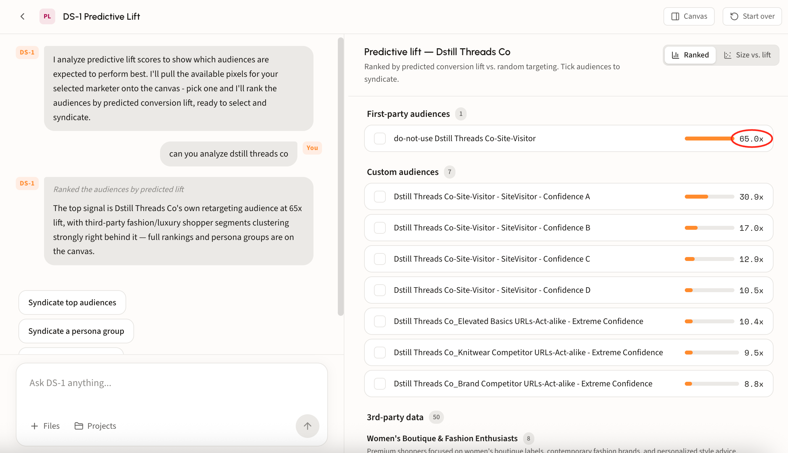
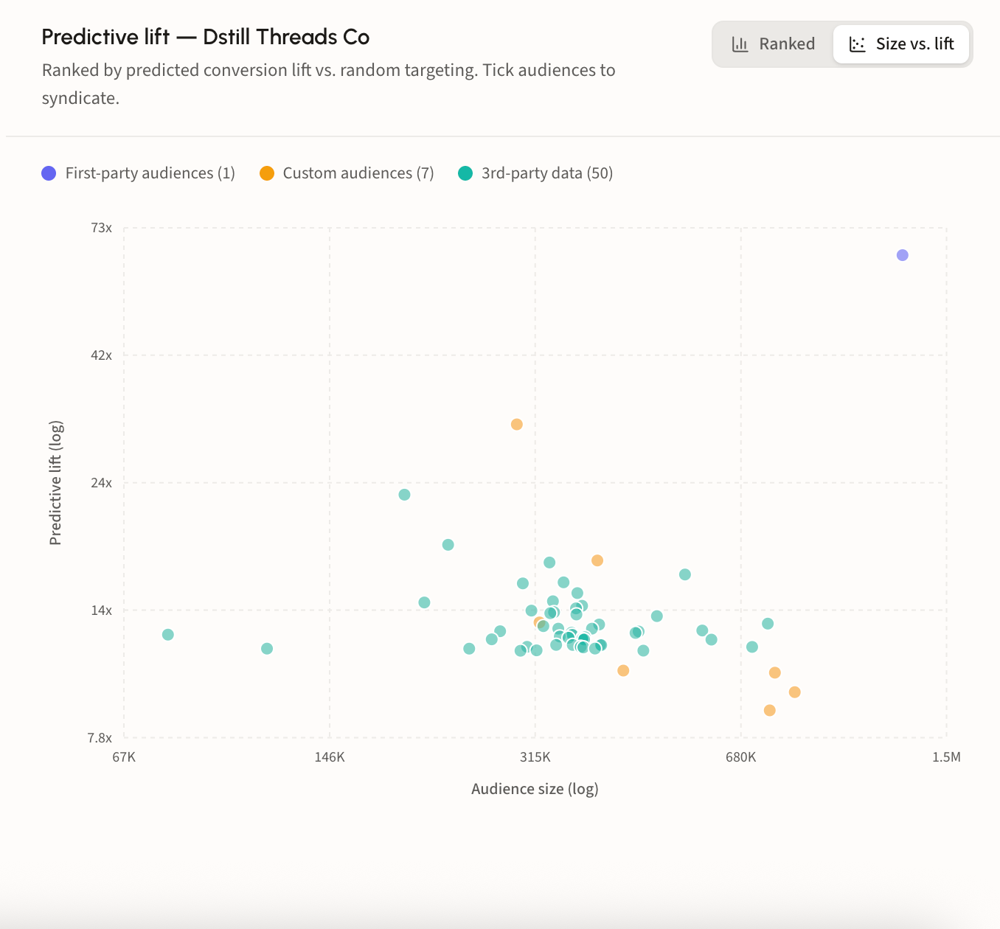

# Analyze predictive lift scores

## What a lift score tells you

Lift analysis always starts from a pixel. The pixel is the conversion signal: DS-1 surfaces every audience relevant to it and scores each one by how much more likely it is to convert than random targeting.

A score of **65.0x** means that audience, measured against this pixel, is expected to perform 65 times better than the baseline. The higher the score, the stronger the expected performance, so lift is the fastest way to rank options against each other rather than guessing from audience names and reach numbers alone.

From one pixel, DS-1 surfaces three kinds of audiences:

* **First-party audiences** from the data the pixel itself collects
* **Custom audiences** modeled for this advertiser
* **3rd-party data**, the prebuilt audiences from the catalog

Every one of them gets a lift score against the same pixel, so you compare like for like.

## When to use it

Use lift scores while you are still shaping the plan, before budget is committed. When a client or media planner wants to weigh several targeting ideas, lift turns the debate into a comparison: pick the pixel, read the scores, and take the strongest into the brief.


No pixel, no lift score. If the advertiser does not have one collecting yet, start with [Create a pixel](create-a-pixel.md).


## Walk through an analysis

### Step 1. Pick a pixel

DS-1 pulls the available pixels for your selected marketer onto the canvas. Pick one and it surfaces the first-party, custom, and 3rd-party audiences relevant to it, ranked by predicted conversion lift against that pixel.

### Step 2. Read the ranking

Results land grouped by source, each audience showing its lift as a bar and a multiple against the pixel's baseline. Grouping matters as much as the ranking: it tells you whether the strongest signal is your own data or something you would have to buy.

* **First-party audiences** from the pixel's own data
* **Custom audiences** modeled for this advertiser, including confidence tiers and act-alike variants
* **3rd-party data** from the prebuilt catalog, further grouped into named persona clusters

<figure><figcaption></figcaption></figure>

### Step 3. Check lift against size

Switch to **Size vs. lift** to plot every audience by reach against its score, a fuller picture than the lift numbers alone.

<figure><figcaption></figcaption></figure>

### Step 4. Select and syndicate

Tick the audiences you want and syndicate them, or use the suggestions in chat to send the top audiences or a whole persona group at once. See [Build and activate to a DSP or SSP](../get-started/activation/programmatic-dsps-ssps.md) for reach sizes and destinations.
