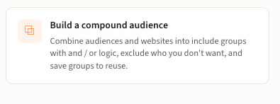
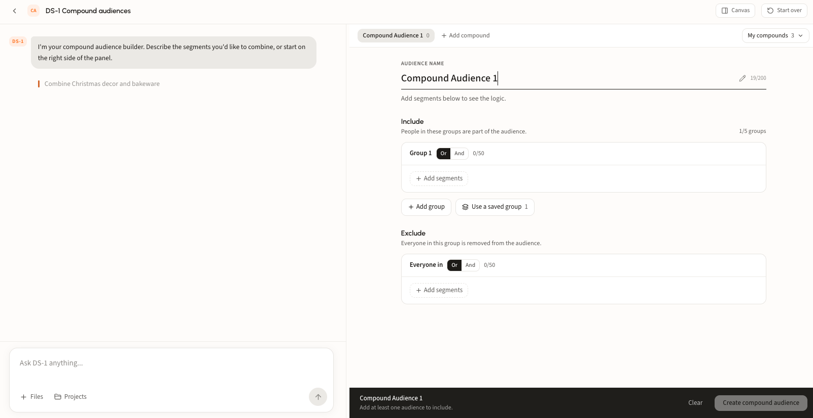
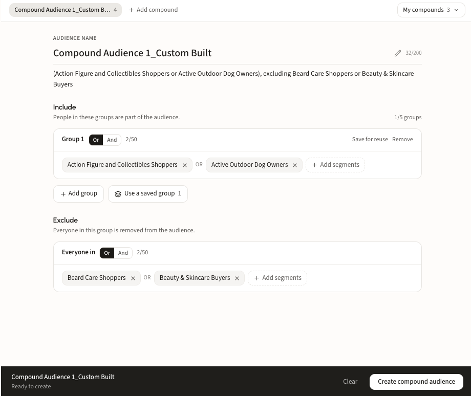
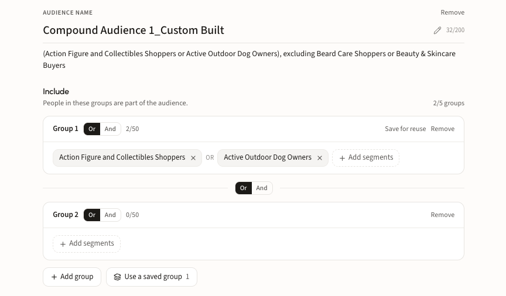
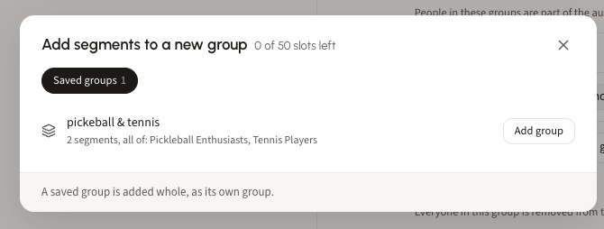
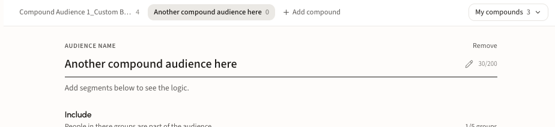
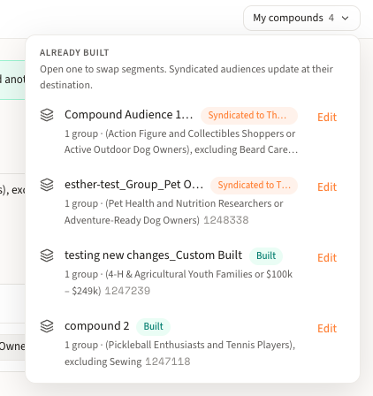

# Build a compound audience

## What a compound audience is

A compound audience combines several segments into one, using boolean logic. You decide who is in, who is out, and how the pieces relate: people in *any* of these segments, people in *all* of them, or any mix of the two across groups. Then you exclude the people you do not want.

Because groups can be combined with **or** and **and**, and segments inside each group can be combined the same way, you can express almost any targeting rule in one audience:

* **(A or B)**: anyone in either segment
* **(A and B)**: only people in both
* **(A or B) and (C or D)**: one from each group
* **(A or B), excluding (E or F)**: remove anyone in the exclusions

The result builds as a single audience and syndicates like any other.

## Limits to know

| | Limit |
| --- | --- |
| Include groups per compound | 5 |
| Segments per group | 50 |
| Exclude groups per compound | 1 |
| Audience name | 200 characters |

## Walk through a compound audience

### Step 1. Open the agent

From the home screen, pick **Build a compound audience** under **Recommended agents**.

<figure><figcaption></figcaption></figure>

### Step 2. Name the audience

The builder opens on the right, with chat on the left. Give the compound a name under **Audience name**. You can also describe the segments you want to combine in chat and let DS-1 fill in the builder.

<figure><figcaption></figcaption></figure>

### Step 3. Add segments to include and exclude

Under **Include**, click **Add segments** to add audiences or websites to Group 1. Under **Exclude**, add the segments to remove from the audience. Switch each group between **Or** and **And** to set how the segments inside it combine.

As you add segments, the line under the name spells out the logic in plain English, so you can read the rule back before you build it.

<figure><figcaption></figcaption></figure>

### Step 4. Combine groups

Click **Add group** to add another include group. A toggle between groups sets whether they combine with **Or** or **And**, independent of the logic inside each one. This is how you build rules like *(A or B) and (C or D)*.

<figure><figcaption></figcaption></figure>

### Step 5. Save and reuse groups

Click **Save for reuse** on any group to keep it for later. To bring a saved group into a compound, click **Use a saved group** and **Add group**. A saved group is added whole, as its own group.

<figure><figcaption></figcaption></figure>

### Step 6. Work on several compounds at once

Click **Add compound** to open another compound in a new tab. Each one has its own name, groups, and logic, and you can switch between them as you work.

<figure><figcaption></figcaption></figure>

### Step 7. Build and syndicate

When the inclusions and exclusions are right, the bar at the bottom reads **Ready to create**. Click **Create compound audience** to build it, then syndicate it to any DSP or SSP partner. See [Build and activate to a DSP or SSP](../get-started/activation/programmatic-dsps-ssps.md) for destinations.

### Step 8. Find and edit your compounds

Every compound you make is saved under **My compounds** in the top right. Each one shows its logic, its status (**Built** or **Syndicated**), and its ID. Click **Edit** to open it and swap segments. Syndicated audiences update at their destination, so there is no need to rebuild and resend.

<figure><figcaption></figcaption></figure>
