# Build targetable segments from any document

## What it does

Campaign planning usually starts with a document: a client brief, an RFP, a media plan, an email thread, a spreadsheet of objectives. This agent starts there too. Upload the file in whatever format it came in and DS-1 reads it, analyzes the key points, and takes you from that analysis to activation in four steps:

1. **Read**: what the document says, broken into findings
2. **Personas**: who those findings describe and how they behave
3. **Audiences**: the audiences that reach those personas
4. **Finalize**: the plan, ready to activate

Each step builds on the decisions you made in the one before it. What you keep in Read shapes the personas, and the personas you keep shape the audience recommendations.

## Walk through a document

### Step 1. Open the agent

From the home screen, pick **Build targetable segments from any document** under **Recommended agents**.

<figure>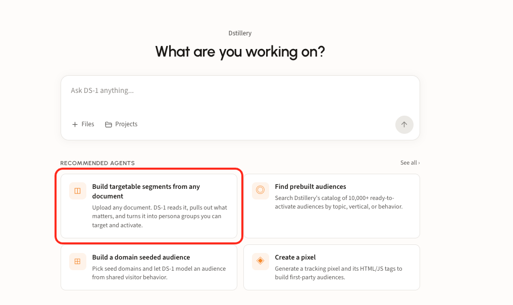<figcaption></figcaption></figure>

### Step 2. Name the plan and upload the document

Give the plan a name, then drop in one file. PDF, Word, PowerPoint, Excel, images, and emails all work, so a screenshot of a client email is as good a starting point as a formal brief. Click **Analyze**.

<figure>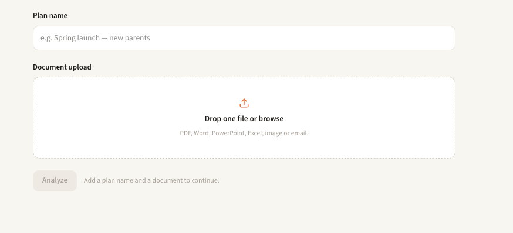<figcaption></figcaption></figure>

### Step 3. Read: review what DS-1 found

The document opens on the left and the analysis on the right. DS-1 identifies what kind of document it is and pulls out the findings relevant to your goals, grouped by the audience each one is about.

<figure>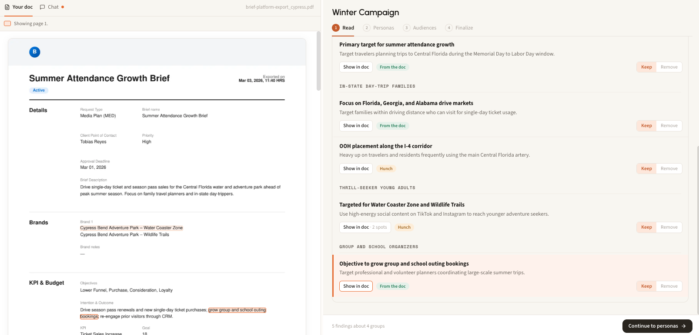<figcaption></figcaption></figure>

Each finding is tagged by where it came from:

* **From the doc**: stated directly in the document
* **Hunch**: DS-1's inference from what the document implies

Click **Show in doc** on any finding to see the passage it came from, highlighted in the document. Then **Keep** or **Remove** each one. Only what you keep is used to build personas, so remove anything that is off-brief or too speculative. When the list looks right, click **Continue to personas**.

### Step 4. Personas: review who you are targeting

DS-1 turns the findings you kept into personas. Each one has a short description and a list of **How they behave**, the behaviors that define it, each with its own **Show in doc** link back to the source.

<figure>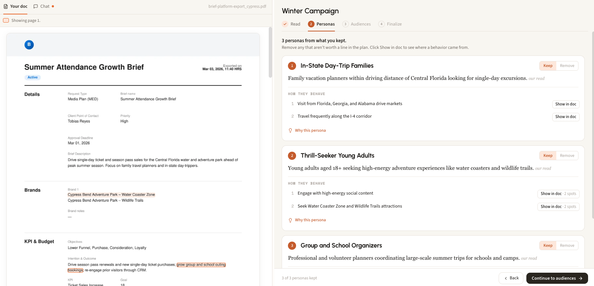<figcaption></figcaption></figure>

Click **Why this persona** to see the rationale: why the group matters for this campaign, the reasons behind it, and a **Worth checking** note on anything the document does not answer.

<figure>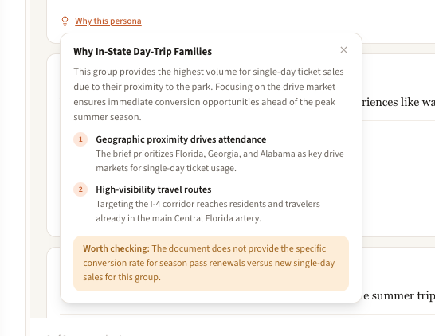<figcaption></figcaption></figure>

As in Read, **Keep** or **Remove** each persona. When you are happy with the set, click **Continue to audiences**.

### Step 5. Audiences: get recommendations

DS-1 recommends audiences based on the findings and personas you kept, so every recommendation traces back to something in the document. You get two audiences for each persona, each tagged with how it was built (**Search LAL**, **Domain Seeded**, **Retail Purchase Intent**) and showing the search terms, sites, or products behind it.

<figure>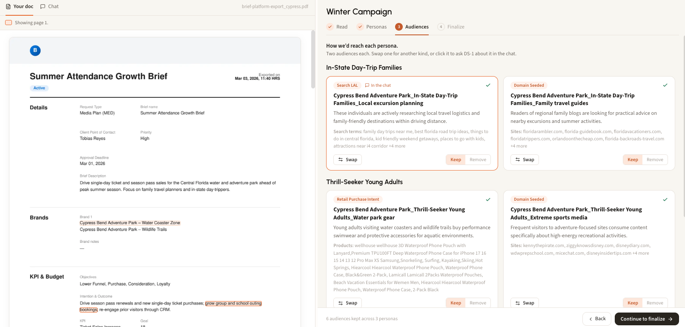<figcaption></figcaption></figure>

The recommendations are a starting point. If you think another audience fits better, you have two ways to change one.

**Swap it.** Click **Swap** on a card to search for a replacement. You can pick from off-the-shelf segments, Dstillery and non-Dstillery, or from Dstillery's custom audience types: **Search terms**, **Retail purchase intent**, and **Domain seeded**. DS-1 puts its recommended replacement for the persona at the top. Click **Use this** to swap it in.

<figure>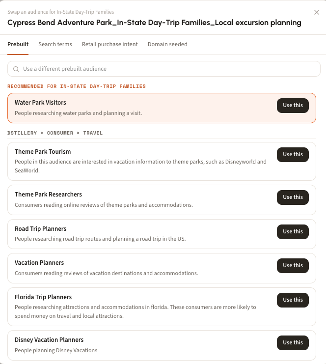<figcaption></figcaption></figure>

**Describe it in chat.** Click any audience card and it attaches to the **Chat** tab on the left. Ask about it or say how you want it changed in plain English, for example "drop it" or "bring back the other one."

<figure>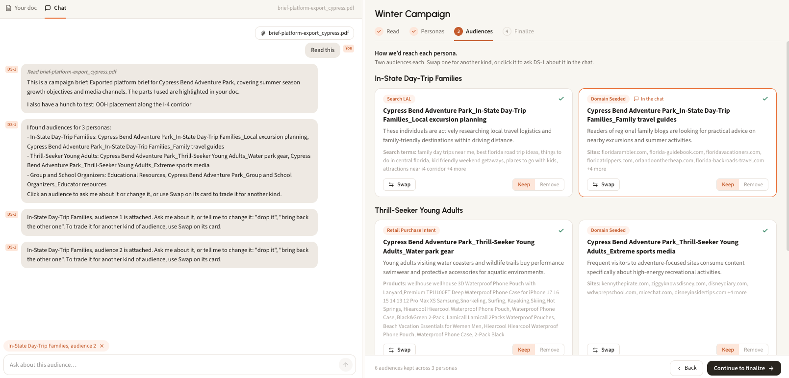<figcaption></figcaption></figure>

**Keep** or **Remove** each audience, then click **Continue to finalize**.

### Step 6. Finalize: build and syndicate

Finalize lists every audience you kept, grouped by persona, with how each one was built and its status. Use **Edit** on a persona to go back and change its audiences. When the list is right, click **Build** and DS-1 builds them within the agent, with no handoff to another tool.

<figure>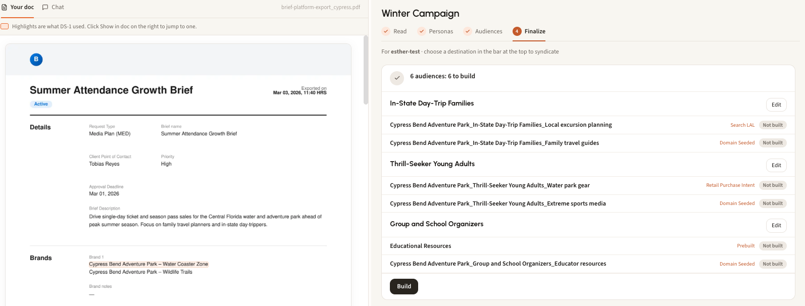<figcaption></figcaption></figure>

Each audience shows where it stands: **Not built**, **Building**, **Built**, or **With team**. Anything that fails says why. Once the audiences are built, choose a DSP or SSP partner in the bar at the top and click **Syndicate**. See [Build and activate to a DSP or SSP](../get-started/activation/programmatic-dsps-ssps.md) for destinations.

Below the list, the **Findings deck** collects every decision you made along the way: the campaign goal, what DS-1 learned from the document, the personas, and the audiences you kept for each. Export it at any point with **Export deck** or **Save as PDF**.

<figure>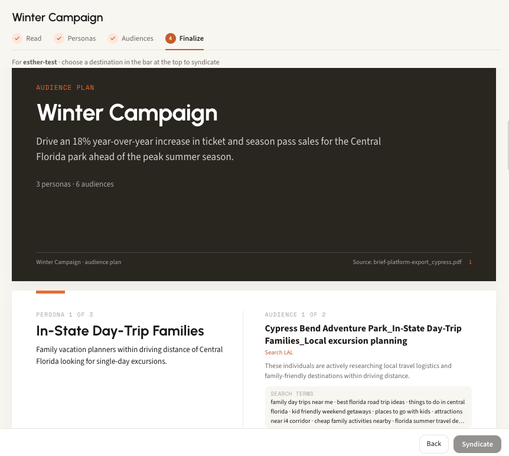<figcaption></figcaption></figure>


Each step only works from what you kept in the step before. To change the recommendations, go **Back** and adjust the findings or personas.



**Tip:** click **How this works** at any point to get a walk through of the screen you are on.


<figure>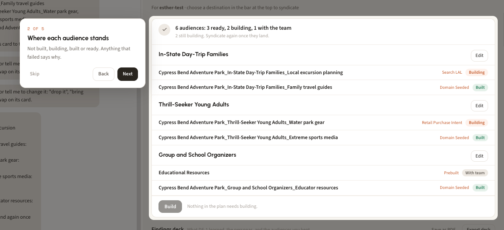<figcaption></figcaption></figure>
